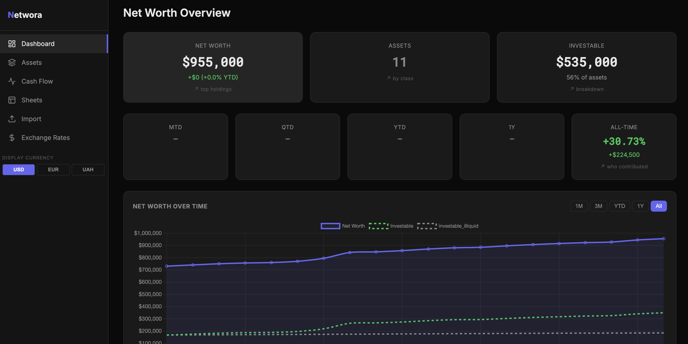
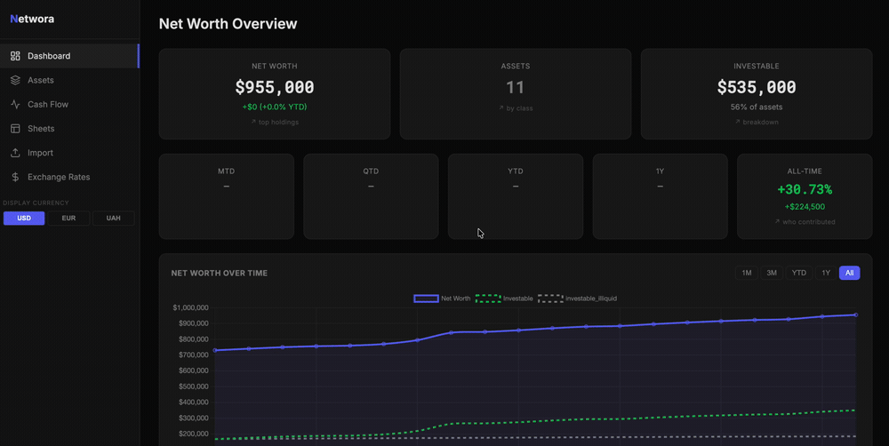
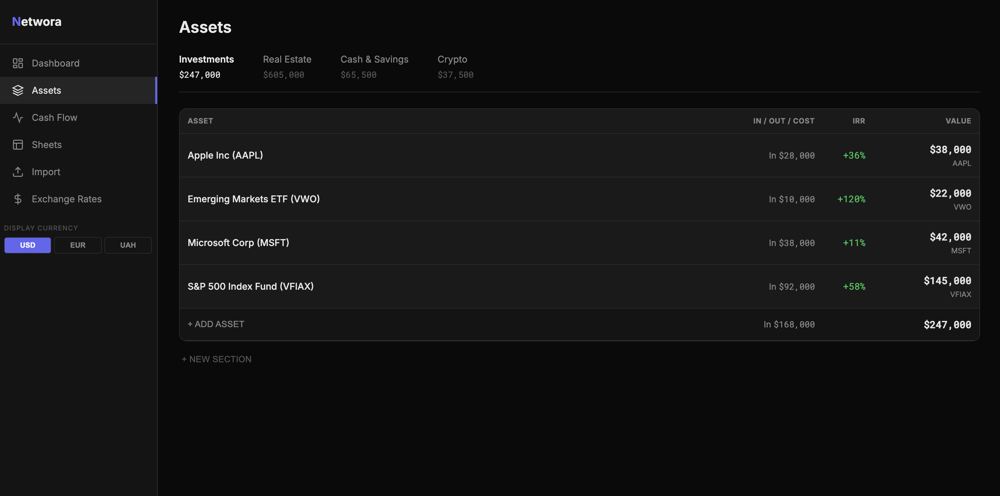
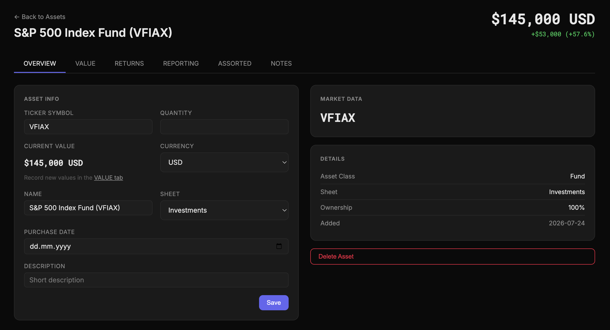
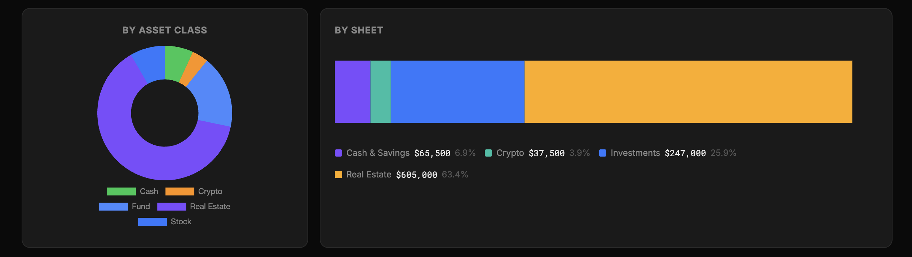
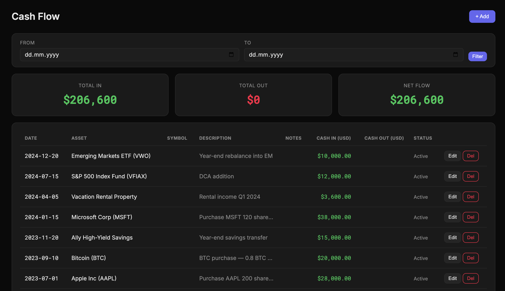
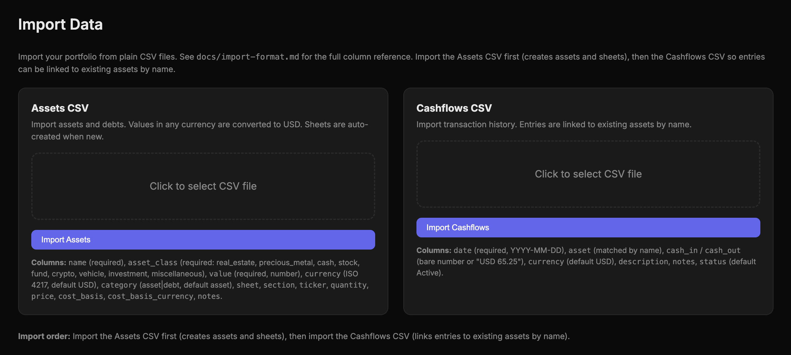
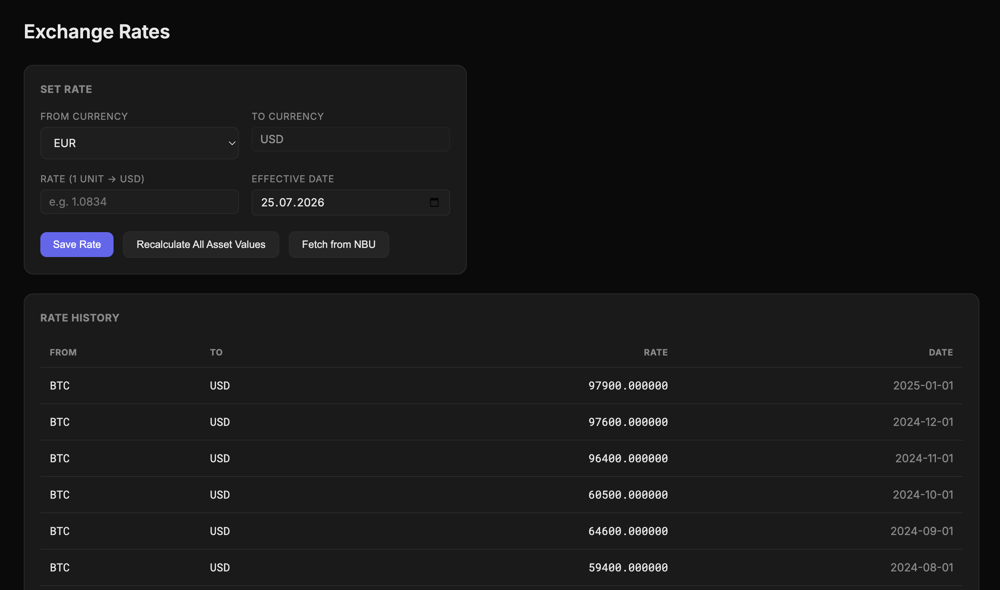

# Networa

[](https://github.com/MykhailoNester/Networa/actions/workflows/ci.yml)
[](LICENSE)


A self-hosted personal net-worth and asset tracker for monitoring assets, debts, cash flows, and net worth over time. Built with FastAPI, HTMX, and Chart.js on a dark-themed UI. Your data stays on your machine in a local SQLite database — no accounts, no cloud, no telemetry.

<p align="center">
  
</p>

> **Security note:** this is a single-user app with **no authentication**. It binds to `127.0.0.1` by default. Only expose it beyond localhost behind a trusted reverse proxy that adds auth — see [SECURITY.md](SECURITY.md).

## Features

- **Dashboard** — net worth summary, YTD change, asset allocation charts
- **Assets** — multi-currency asset list with inline value editing and gain/loss tracking
- **Cash Flow** — log contributions, withdrawals, and dividends per asset
- **Exchange Rates** — manual FX rates with one-click USD recalculation
- **Import** — bulk import of assets and cash flows from CSV (see [docs/import-format.md](docs/import-format.md))
- **Snapshots** — automatic daily snapshots + manual trigger; historical net worth chart

## Demo

<p align="center">
  
</p>

## Screenshots

<table>
  <tr>
    <td width="50%"><br><sub><b>Assets</b> — multi-currency holdings with cost basis, IRR and gain/loss, grouped into sheets</sub></td>
    <td width="50%"><br><sub><b>Asset detail</b> — overview, value history, returns and notes per asset</sub></td>
  </tr>
  <tr>
    <td><br><sub><b>Allocation</b> — breakdown by asset class and by sheet</sub></td>
    <td><br><sub><b>Cash flow</b> — contributions, withdrawals and dividends with in / out / net totals</sub></td>
  </tr>
  <tr>
    <td><br><sub><b>CSV import</b> — bring in assets and cash flows from any source</sub></td>
    <td><br><sub><b>Exchange rates</b> — manual FX with one-click USD recalculation</sub></td>
  </tr>
</table>

## Requirements

- Python 3.12+

## Run

```bash
# 1. Create and activate virtual environment
python -m venv .venv
source .venv/bin/activate

# 2. Install dependencies
pip install -r requirements.txt

# 3. Run the development server
python main.py
```

The app will be available at **http://localhost:8000**.

On first run it creates `data/networa.db` — your own database, excluded from git —
and seeds it with a small sample portfolio so the dashboard isn't blank. Every
sample row is labelled "Sample data — safe to delete"; delete them as you add
real holdings, or start completely empty with `SEED_SAMPLE_DATA=0`.

To browse the richer dataset used for the screenshots above:

```bash
DB_NAME=demo.db python main.py
```

> `data/demo.db` is committed to this repository. It exists to demo the UI —
> keep real holdings out of it, or you risk publishing them.

### Using your own database

Point the app at a different database with either environment variable:

```bash
# Use a different file name under data/
DB_NAME=mydata.db python main.py

# Or provide a full path anywhere on disk
DATABASE_PATH=/absolute/path/to/mydata.db python main.py
```

`DATABASE_PATH` takes precedence over `DB_NAME`. The SQLite database is created
automatically on first run if it does not yet exist. Anything matching
`data/*.db` other than `demo.db` is gitignored.

The `HOST` and `PORT` environment variables override the default `127.0.0.1:8000`.
`ALLOWED_HOSTS` controls which `Host` headers the app answers to — see
[SECURITY.md](SECURITY.md).

---

## Database Backup

A backup script is included at `scripts/backup.sh`. It uses SQLite's online backup API (safe with WAL mode while the app is running).

It backs up whichever database the app is configured to use (`DATABASE_PATH`,
then `DB_NAME`, then the `data/networa.db` default), and names the file after it.

```bash
# Backup to ./backups, keep last 30 days
./scripts/backup.sh

# Custom directory and retention
./scripts/backup.sh /mnt/backups 60

# Keep all backups
./scripts/backup.sh ./backups 0
```

For automated backups, add a cron entry:

```
0 3 * * * /path/to/Networa/scripts/backup.sh >> /var/log/nw-backup.log 2>&1
```

---

## Project Structure

```
.
├── main.py                  # Entry point
├── app/
│   ├── __init__.py          # App factory, Jinja2 setup
│   ├── config.py            # Settings
│   ├── database.py          # Async SQLite connection + schema init
│   ├── schema.sql           # Canonical database schema (single source of truth)
│   ├── models.py            # Pydantic schemas
│   ├── forms.py             # Typed form-field helpers
│   ├── routers/             # FastAPI route handlers
│   └── services/            # Business logic
├── templates/               # Jinja2 HTML templates
├── scripts/                 # Utility scripts (seed_demo.py, backup.sh)
├── docs/                    # Documentation (import format, etc.)
└── data/                    # SQLite databases (only demo.db is committed;
                             #   your networa.db stays local)
```

The schema lives in a single `app/schema.sql` applied idempotently on startup —
there is no migrations directory. To rebuild the demo database from scratch:

```bash
python scripts/seed_demo.py
```

---

## Import Format

Assets and cash flows can be imported from CSV files. Go to **Import** in the
sidebar and upload the file. The two supported CSV shapes (Assets CSV and
Cashflows CSV) are documented in [docs/import-format.md](docs/import-format.md).

---

## Contributing

Contributions are welcome. Please read [CONTRIBUTING.md](CONTRIBUTING.md) for the
development setup, the local check gate (`ruff` + `mypy`), and coding
conventions, and note the [Code of Conduct](CODE_OF_CONDUCT.md).

## Security

This app has no authentication and is intended for local, single-user
self-hosting. See [SECURITY.md](SECURITY.md) for the trust model and how to
report a vulnerability privately.

## License

Networa is licensed under the **GNU Affero General Public License
v3.0** — see [LICENSE](LICENSE). Bundled and third-party components remain under
their own licenses; see [THIRD-PARTY-NOTICES.md](THIRD-PARTY-NOTICES.md).

Copyright (C) 2026 Mykhailo Nester.
